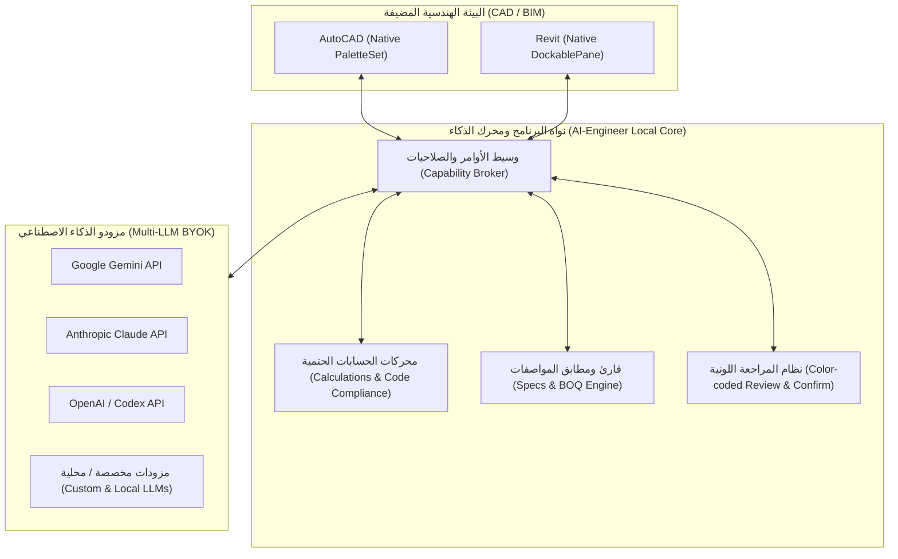

# ميثاق المنتج والهدف النهائي الشامل — AI-Engineer

**تاريخ التوثيق:** 2026-11-09  
**حالة الوثيقة:** المرجع التوجيهي والهدف التشغيلي الدائم لجميع جلسات التطوير والأجهزة المختلفة.  
**مالك المشروع وقرار الاعتماد:** المهندس / حمادة جمال (Hamada Gamal).

---

## 1. الرؤية العامة للهدف (Product Vision)
بناء برنامج هندسي متكامل وقوي باسم **AI-Engineer** يتم تثبيته عبر برنامج تنصيب مستقل (Windows Installer) ليعمل كمساعد ذكي فائق القدرة ورفيق هندسي خبير داخل برنامجي **AutoCAD** و **Revit**، حيث يتواصل معه المهندس عبر نافذة محادثة داخلية سلسة وطبيعية بكامل الصلاحيات الهندسية المعتمدة، مع الحفاظ على التحكم البشري الصارم ودقة الحسابات الهندسية ومطابقة مواصفات المشاريع.

---

## 2. الركائز الأساسية للمنتج (Core Architecture Pillars)

---

## 3. تفاصيل المتطلبات الهندسية والوظيفية

### أ) برنامج التثبيت المستقل وخيارات المزوّدات (Installer & Multi-LLM BYOK):
1. **برنامج تثبيت مخصص (Setup / Installer):**
   - حزمة تثبيت Windows رسمية تقوم بفحص تلقائي لوجود وإصدارات AutoCAD و Revit وتثبيت الإضافات الخاصة بهما (.bundle و .addin) وربط الخدمة المحلية تلقائياً.
2. **اختيار وإدخال مفاتيح الذكاء الاصطناعي (Selectable AI Providers & API Keys):**
   - شاشة واضحة أثناء التثبيت أو من خلال نافذة الإعدادات تتيح اختيار مزودي الذكاء الاصطناعي النشطين:
     - **Gemini API** (Google)
     - **Claude API** (Anthropic)
     - **Codex / OpenAI API**
     - إمكانية إضافة أي مزود ذكاء اصطناعي مستقبلي عبر API Key و Endpoints مخصصة.
   - حفظ المفاتيح محلياً بشكل مشفر وآمن عبر (Windows Credential Manager / DPAPI) لحماية بيانات المهندس.

---

### ب) تجربة المحادثة المباشرة داخل AutoCAD و Revit:
1. **واجهة الشات الأصلية:**
   - لوحة أصلية داخل AutoCAD (`PaletteSet`) وداخل Revit (`DockablePane`) تعمل بسلاسة دون نوافذ خارجية معطلة لسير العمل.
   - تجربة محادثة عربية / إنجليزية ذكية وطبيعية تفهم المصطلحات الهندسية وسياق المخطط بالكامل.
2. **رفع ومطابقة مواصفات المشروع (Project Specifications & Submittals):**
   - إمكانية سحب وإفلات كراسات المواصفات (PDF/Excel) في نافذة الشات ليقوم البرنامج بقراءتها وتطبيق شروط المالك وجداول الكميات والاعتمادات على الرسم والمخطط تلقائياً.

---

### ج) دورة الرسم والتعديل الآمنة ونظام المراجعة اللوني (Color-Coded Review Lifecycle):
1. **الرسم والتعديل المبدئي بلون المراجعة (Review State):**
   - عندما يُطلب من البرنامج رسم عنصر جديد، أو تعديل مسارات، أو إضافة مكونات، يقوم البرنامج بتنفيذ التعديل **بلون مخصص ومميز جداً للمراجعة** (مثل اللون الأحمر أو البرتقالي أو طبقة مراجعة مستقلة `_AI_PREVIEW`).
2. **فحص المهندس والاعتماد البشري:**
   - يرى المهندس التعديل المقترح بعينيه على المخطط للتأكد من ملاءمته وخلوه من التعارضات.
3. **التثبيت بعد الموافقة ("تمام"):**
   - بمجرد أن يكتب المهندس في الشات "تمام" أو يضغط زر "اعتماد":
     - يتم تحويل العناصر المعدلة فوراً إلى ألوانها وطبقاتها وخصائصها الهندسية الأصلية والمعتمدة.
     - يتم حفظ التعديلات نهائياً مع المخطط وتوثيق العملية في سجل التدقيق (Audit Log).
4. **التراجع الكامل والآمن (Rollback / Undo):**
   - إمكانية إلغاء التعديل فوراً والرجوع لحالة الرسم السابقة دون أي تشويه للملف الأصلي.

---

### د) القدرات الهندسية والتحليلية الشاملة:
1. **الرسم والتعديل الذكي:** رسم وتعديل مسارات الكابلات، الإضاءة، المخارج، القواطع، اللوحات، وتوزيع الأحمال.
2. **الحسابات الهندسية الحتمية:**
   - حسابات هبوط الجهد (Voltage Drop)، تيار القصر (Short Circuit)، وتحديد مقاسات الكابلات وسعة القواطع وفق الأكواد القياسية.
3. **الحصر وجداول الكميات (BOQ Extraction):**
   - حصر دقيق للعناصر والمسارات وربطها بجداول كميات منظمة قابلة للتصدير لـ Excel أو إدراجها كجداول في الـ CAD.
4. **دليل الرموز والمصطلحات (Legend & Tags):**
   - توليد وتحديث جداول الرموز (Legends) والملاحظات الفنية تلقائياً بناءً على ما هو مستخدم فعلياً داخل المشروع.

---

### هـ) الرؤية البصرية الذكية والاقتصادية (On-Demand Visual Inspection):
1. **أولوية القراءة الرقمية المنظمة (Structured CAD Data First):**
   - يعتمد المساعد بنسبة 90%+ على قراءة الكائنات والخصائص الهندسية برمجياً عبر الـ APIs الرسمية (سرعة فائقة واستهلاك صفر من كوتا الصور).
2. **الفحص البصري للشاشة عند الضرورة فقط (Selective Screen Capture):**
   - للمساعد القدرة على رؤية الـ Viewport أو الشاشة فقط في الحالات التي تتطلب حكماً بصرياً أو استكشاف تعارض مكاني، وذلك لحماية رصيد وكوتا الـ Tokens وتوفير باقة الذكاء الاصطناعي للمستخدم.

---

## 4. خطة المراحل التنفيذية (Milestone Execution Roadmap)

| المرحلة | النطاق | المخرجات الرئيسية |
|---|---|---|
| **M1: الأساس والاختبارات (C0/C1)** | ترتيب ملفات النواة، توحيد الاختبارات | نجاح 100% من الاختبارات، تنظيف كود `ProjectConfigError` ومطابقة الـ API Catalog. |
| **M2: واجهة الشات والمزودات** | لوحة AutoCAD و Revit ومحرك الـ Multi-LLM | واجهة محادثة أصلية داخل البرنامجين، شاشة ضبط وإدخال مفاتيح (Gemini/Claude/Codex). |
| **M3: نظام المراجعة والاعتماد اللوني** | دورة الرسم، اللون المؤقت، وأمر "تمام" | تنفيذ التعديل بلون المراجعة ثم تثبيته بالألوان الأصلية عند كتابة "تمام". |
| **M4: محرك المواصفات والحسابات** | رفع ملفات PDF/Excel وربط الكود الهندسي | قراءة كراسة المواصفات، حسابات الكابلات واللوحات، واستخراج الـ Legend والـ BOQ. |
| **M5: الرؤية الاقتصادية وبرنامج التثبيت** | التقاط الشاشة عند الحاجة + مثبت Windows | أداة لقطة الشاشة الانتقائية وحزمة Setup تنفيذية متكاملة لجميع الأجهزة. |

